# Sistema de Gestão de Resíduos

## Descrição

Este projeto consiste em um sistema de gerenciamento de ocorrências de descarte irregular de resíduos no município de Amparo.

O sistema permite cadastrar, consultar, atualizar e excluir usuários e ocorrências, além de realizar login de usuários e consultar a quantidade de ocorrências que já foram tratadas.

## Diagrama de Classes

O diagrama de classes representa a estrutura do sistema, suas classes, atributos e relacionamentos.

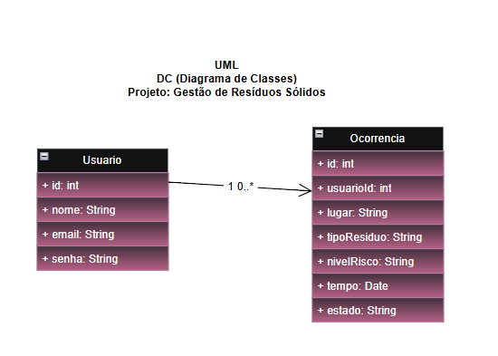

## Tecnologias

As seguintes tecnologias foram utilizadas no desenvolvimento:

- **Node.js:** ambiente de execução JavaScript.
- **Express:** framework utilizado para criação das rotas da API.
- **MariaDB:** sistema de gerenciamento do banco de dados.
- **MySQL2:** biblioteca utilizada para conectar o Node.js ao banco de dados.
- **Thunder Client:** ferramenta utilizada para testar as requisições HTTP.

## Passo a passo para testar

### 1. Pré-requisitos

Antes de executar o projeto, é necessário ter instalado:

- Node.js
- MariaDB
- Thunder Client, Insomnia ou Postman

### 2. Configuração do banco de dados

1. Inicie o serviço do MariaDB.
2. Abra seu gerenciador de banco de dados.
3. Execute o script localizado em `db/script.sql`.
4. Verifique se o banco de dados `gestao_residuos` foi criado corretamente.

### 3. Instalação das dependências

Abra o terminal na pasta do projeto e execute:

```bash
npm install
```

Caso as dependências ainda não estejam instaladas, execute:

```bash
npm install express cors mysql2
```

### 4. Inicialização do servidor

No terminal, execute:

```bash
node server.js
```

O servidor deverá iniciar na porta 3000:

```text
http://localhost:3000
```

### 5. Testando a API

Utilize o Thunder Client, Insomnia ou Postman para realizar as requisições HTTP.

#### Usuários

| Método | Rota | Funcionalidade |
|---|---|---|
| GET | `/usuarios` | Listar usuários |
| GET | `/usuarios/:id` | Buscar usuário por ID |
| POST | `/usuarios` | Cadastrar usuário |
| POST | `/usuarios/login` | Realizar login |
| PUT | `/usuarios/:id` | Atualizar usuário |
| DELETE | `/usuarios/:id` | Excluir usuário |

#### Ocorrências

| Método | Rota | Funcionalidade |
|---|---|---|
| GET | `/ocorrencias` | Listar ocorrências |
| GET | `/ocorrencias/:id` | Buscar ocorrência por ID |
| POST | `/ocorrencias` | Cadastrar ocorrência |
| PATCH | `/ocorrencias/:id` | Atualizar ocorrência |
| DELETE | `/ocorrencias/:id` | Excluir ocorrência |
| GET | `/ocorrencias/resumo` | Consultar quantidade de ocorrências tratadas |

## Prints dos testes

Registros dos testes realizados utilizando o Thunderclient

**Cadastro de usuário:**

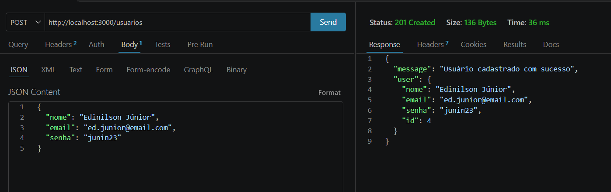

**Listagem de usuarios:**

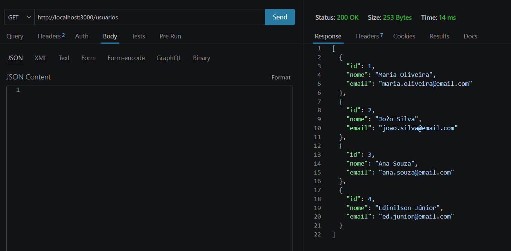

**Atualizar usuário:**

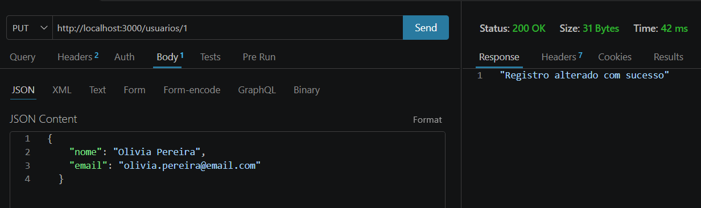
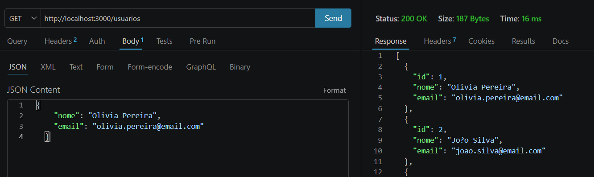

**Login de usuário:**

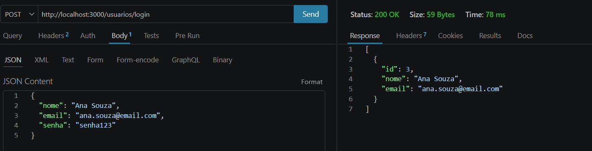

**Exclusão de usuário:**

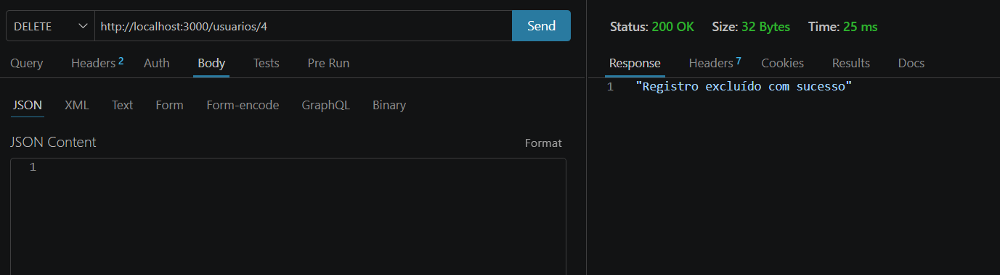

**Cadastro de ocorrências:**

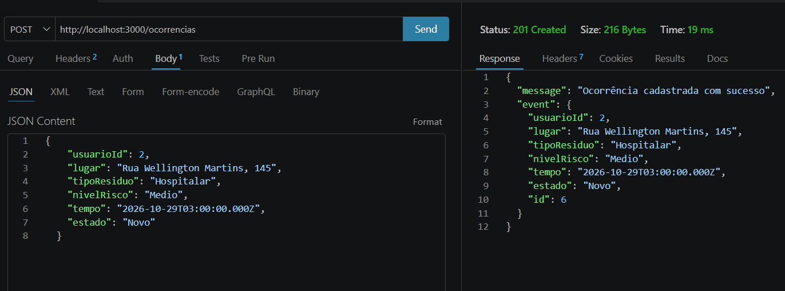

**Listagem de ocorrências:**

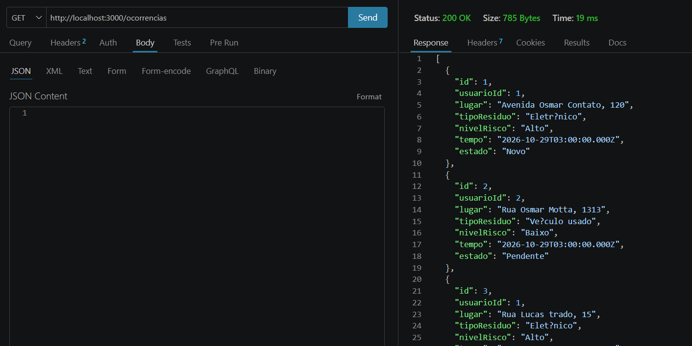

**Atualizar ocorrência:**

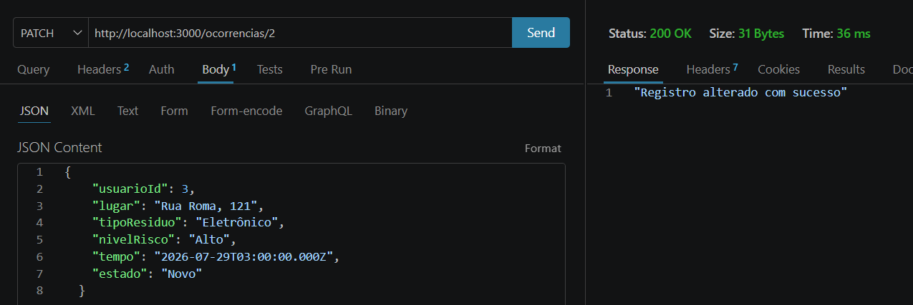
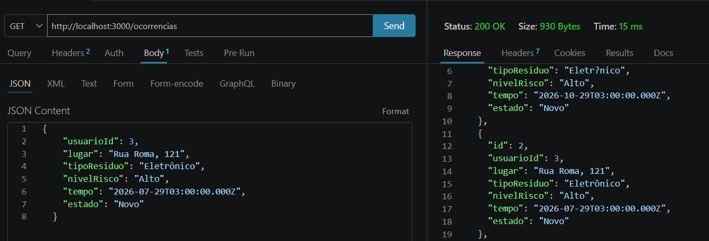

**Resumo de ocorrências tratadas:**

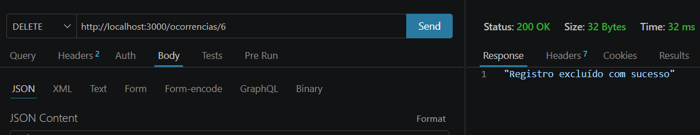

**Exclusão de ocorrência:**


